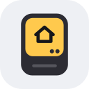

<picture>
  <source media="(prefers-color-scheme: dark)" srcset="docs/icon-dark.svg">
  
</picture>

# Porchlight

Porchlight is a compact Home Assistant widget for Android, built for the Z Flip cover screen. It
puts your smart home on the cover screen, so you can control it without unfolding the phone, and it
works as a regular home-screen widget too.

## 🚀 Quick start

> **Dependencies:**
>
> - An Android phone running Android 12 (API 31) or later. Porchlight is tested on a Galaxy Z Flip 5.
> - [Home Assistant](https://www.home-assistant.io/installation/), reachable from the phone, with
>   your lights grouped into areas.
> - [Android Studio](https://developer.android.com/studio), which comes with the JDK 21 and Android
>   SDK the build needs. Without Android Studio you need JDK 21 and the
>   [Android SDK command-line tools](https://developer.android.com/tools).

There are no prebuilt APKs, because your home config is built into the app.

1. **Clone this repository.**

   Run this in a terminal:

   ```sh
   git clone https://github.com/faishasj/porchlight.git
   cd porchlight
   ```

2. **Create your home config.**

   Copy the example config, then edit `home.yaml` to match your home (see
   [Usage](#-usage)).

   ```sh
   cp home.example.yaml home.yaml
   ```

3. **Build and install the app.**

   Plug in your phone with USB debugging on, then run:

   ```sh
   ./gradlew installDebug
   ```

   You can also open the folder in Android Studio and press **Run**.

4. **Create a Home Assistant token.**

   In Home Assistant, open your profile, go to **Security**, and create a long-lived access token.
   It needs to belong to an admin user, because the widget fetches everything through
   `/api/template`, which only admins can call.

5. **Connect Porchlight to Home Assistant.**

   Open Porchlight, enter your local URL, an optional remote URL and the token, then tap
   **Test & save**. Use https where you can (see [Security](#-security)).

6. **Let Porchlight run in the background.**

   On the phone, go to Settings → Apps → Porchlight → Battery and choose **Unrestricted**. Samsung
   restricts newly sideloaded apps, and the widget can't refresh until you change this.

7. **Add the widget.**

   For the cover screen, go to Settings → Cover screen → Widgets and turn on **Porchlight**. For the
   home screen, add it from the widget picker. Its minimum size is 352 × 339 dp, which is wider than
   a 4-column grid on some phones. If it doesn't fit, lower the display density:

   ```sh
   adb shell wm density 300
   ```

## 📘 Usage

Porchlight is configured by `home.yaml` in the repository root. Lights and scenes aren't listed:
each room shows every light and scene in its Home Assistant area. Rebuild and reinstall after any
change. [home.example.yaml](home.example.yaml) has every option, with comments.

### Example

```yaml
rooms:
  - area: living_room
    label: Living
    icon: sofa-outline
    clean_script: script.vacuum_living_room
  - area: bedroom
    label: Bedroom
vacuum: vacuum.robot_vacuum
tv:
  entity: media_player.living_room_tv
  label: Living room TV
all_off_script: script.all_off
sensors:
  - entity: sensor.outdoor_temperature
    label: Outside
    icon: thermometer
    unit: °C
```

### Configuration reference

#### Top-level keys

| Key              | Type       | Required | Effect                                                        |
| ---------------- | ---------- | -------- | ------------------------------------------------------------- |
| `rooms`          | list       | Yes      | Rooms shown on the Lights screen, in order.                   |
| `vacuum`         | `vacuum.*` | No       | Adds the Vacuum screen.                                       |
| `tv`             | mapping    | No       | Adds the TV screen.                                           |
| `all_off_script` | `script.*` | No       | Adds All off to the House screen. Needs two taps within 10 s. |
| `sensors`        | list       | No       | Read-only tiles shown on the House screen.                    |

The House screen appears when `all_off_script` or `sensors` is set.

#### Room

Each item in `rooms` supports:

| Key            | Type       | Required | Default             | Effect                                                   |
| -------------- | ---------- | -------- | ------------------- | -------------------------------------------------------- |
| `area`         | HA area ID | Yes      |                     | Area whose lights and scenes the room shows. Must be unique. |
| `label`        | text       | Yes      |                     | Tile name.                                               |
| `icon`         | icon       | No       | `lightbulb-outline` | Tile icon.                                               |
| `clean_script` | `script.*` | No       |                     | Adds a tile for the room on the Vacuum screen.           |

#### TV

When `tv` is set, it supports:

| Key      | Type             | Required | Effect                  |
| -------- | ---------------- | -------- | ----------------------- |
| `entity` | `media_player.*` | Yes      | Media player to control. |
| `label`  | text             | No       | Shown under Play/Pause. |

#### Sensor

Each item in `sensors` supports:

| Key      | Type      | Required | Default       | Effect                         |
| -------- | --------- | -------- | ------------- | ------------------------------ |
| `entity` | entity ID | Yes      |               | Entity to display. Any domain. |
| `label`  | text      | Yes      |               | Tile name.                     |
| `icon`   | icon      | No       | `eye-outline` | Tile icon.                     |
| `unit`   | text      | No       |               | Shown after the state.         |

### Icons

`icon:` takes any [Material Design Icons](https://pictogrammers.com/library/mdi/) name, the same set
Home Assistant uses. `sofa-outline` and HA's `mdi:sofa-outline` both work. Lights show the icon set
on them in Home Assistant, or a bulb if none is set. The whole font is bundled, so every icon works
offline.

### Widget

- Back (top left) goes up a level. Refresh (top right) fetches everything again.
- The widget refreshes after every tap and every 15 minutes.
- Tap a light's icon to toggle it, or its name to open its controls.
- To change the theme, tap the gear in the app and choose System, Light or Dark.

## 🔒 Security

The token goes with every request and can do anything your HA admin user can, so use https if you
can, through Home Assistant's own TLS, Tailscale HTTPS (`*.ts.net`) or Nabu Casa. Plain http is only
accepted for private addresses, such as `192.168.x.x`, `10.x.x.x`, `.local` or `.ts.net`, and
Porchlight only uses an http URL on Wi-Fi, Ethernet or a VPN, never on mobile data.

Porchlight stores the token encrypted with a key in the Android Keystore. Changing a URL asks for the token again.

When the phone is locked with a PIN, pattern or biometrics, light, vacuum and All on/off taps wait
for an unlock and the widget shows "Unlock to use". Scenes and TV play/pause still work.

## 🛠️ Development

Follow the [Quick start](#-quick-start) to install JDK 21, the Android SDK and a local `home.yaml`.
You can work in Android Studio or use the Gradle wrapper from the repository root.

### Project layout

- `app/src/main/java/dev/faisha/porchlight/widget/` contains the Glance widget UI, actions and
  refresh scheduling.
- `app/src/main/java/dev/faisha/porchlight/control/` contains the full-screen light controls.
- `app/src/main/java/dev/faisha/porchlight/data/` contains Home Assistant access, configuration and
  persisted settings.
- `app/src/test/` contains the JVM unit tests.

At build time, Gradle validates both `home.example.yaml` and your local `home.yaml`, then converts
the selected config to the `home.json` bundled with the app. Invalid keys, entity IDs and icon names
therefore fail the build with an error describing the problem.

### Common commands

```sh
# Run the JVM unit tests
./gradlew testDebugUnitTest

# Run Android lint
./gradlew lintDebug

# Build a debug APK
./gradlew assembleDebug

# Build and install on a connected device
./gradlew installDebug
```

### Updating Material Design Icons

The app bundles the Material Design Icons font and its icon-name index for offline use. To update
both files, install `curl` and Python 3, then run:

```sh
tools/update-mdi.sh
./gradlew testDebugUnitTest
```

Issues and pull requests are welcome.

## 📄 License

Porchlight is released under the [MIT License](LICENSE). The icons inside the app are
[Material Design Icons](https://pictogrammers.com/library/mdi/) by Pictogrammers, under the
[Apache License 2.0](app/src/main/assets/mdi/LICENSE).
